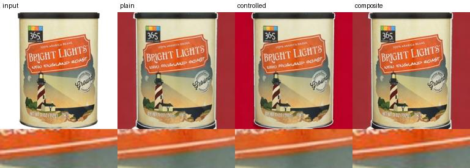

# Product background editing

Replace the background of a public product photograph while inspecting the printed label, brand mark and object contour. All comparisons below use the same input and seed.



With a CUDA-enabled environment, run `python run.py demo` for one product. The first run obtains the pinned Yahoo model (about 6.2 GiB of weights). To share it across clean clones, set VISION_MODEL_CACHE to the directory containing the yahoo-background subfolder.

## Installation and reproduction

Use Python 3.11 and CUDA-enabled PyTorch 2.4.1. Install the remaining packages with `python -m pip install -r requirements-verified.txt`. The verified machine used PyTorch 2.4.1+cu121, an RTX 4060 Laptop GPU with 8 GB VRAM and CPU offload. Model files remain outside Git.

```sh
python -m unittest discover -s tests
python -m src.upstream_example
python run.py demo
python run.py reproduce
python run.py evaluate
```

The upstream check uses the original 512×512 swan image, saved foreground mask, bedroom prompt, seed 13 and 20 steps from the Yahoo notebook. Locally generated images differed from the two images embedded by the authors by 1.10 and 0.82 mean intensity levels respectively (RGB byte scale). The author images and working copies stay in the ignored cache. [Upstream run record](results/upstream/run.json)

## Product experiment

Four real catalog products, two development and two held out, receive red and blue studio requests at 384×384 with 12 inference steps. The same Yahoo diffusion backbone runs at control scale 0 (plain) or 1 (foreground-controlled). The third control pastes original foreground pixels back onto the plain result. Metrics below average the four held-out requests. Lower error is better; hue coverage measures the fraction of background pixels matching the requested dominant color.

| Method | Foreground MAE / 255 | Boundary-ring MAE / 255 | Background hue coverage |
|---|---:|---:|---:|
| Plain inpainting | 10.12 | 41.12 | 64.57% |
| Foreground-controlled | 10.46 | 40.00 | 71.47% |
| Hard composite | 0.00 | 33.52 | 64.57% |

Control increased hue coverage in this small set, with slightly higher average foreground error. Hard compositing copies pixels exactly inside the mask. The boundary score also counts legitimate changes to background pixels. Color dominance is a narrow test for a solid-color backdrop. Packaging inspection crops were chosen on the original photographs solely to visualize text, marks and boundaries; no OCR accuracy is inferred.

[Coffee label and logo](results/formal/details-B074H6ZXT5.jpg) · [Shampoo label and logo](results/formal/details-B0752GQ94S.jpg) · [Lowest controlled scene-score case](results/formal/lowest-scene-score.jpg) · [Per-case scores](results/formal/scores.csv) · [Measured timing, peak memory and settings](results/formal/manifest.json)

## Architecture and handoff

- `src/fetch_yahoo.py` loads the author's original nine-channel implementation and verifies the model's immutable Git blob IDs and LFS SHA-256 values listed in `configs/yahoo-files.json`. Interrupted transfers resume from checked byte ranges.
- `src/data.py` fetches ABO packshots by ID, verifies their hashes and extracts a foreground mask from the near-white border. A two-object input is excluded because the mask procedure retains one connected object. White packaging can be under-segmented.
- `run.py` runs paired alternatives and recomputes evaluation from saved images. Pass `--output` to keep an independent reproduction separate from the shipped results.
- `src/prepare_examples.py` exports the P01/P13 handoff. [The small bundle](examples/products/manifest.json) contains four input PNGs, masks, prompts and per-file SHA-256 values.

[Data attribution](data.md) · [Upstream provenance](UPSTREAM.md) · [Handoff](HANDOFF.md)

The clean-clone GPU rerun produced byte-identical PNGs for all 24 method outputs, with zero differences across the three computed metrics. [Independent audit](results/clean-clone.json)
